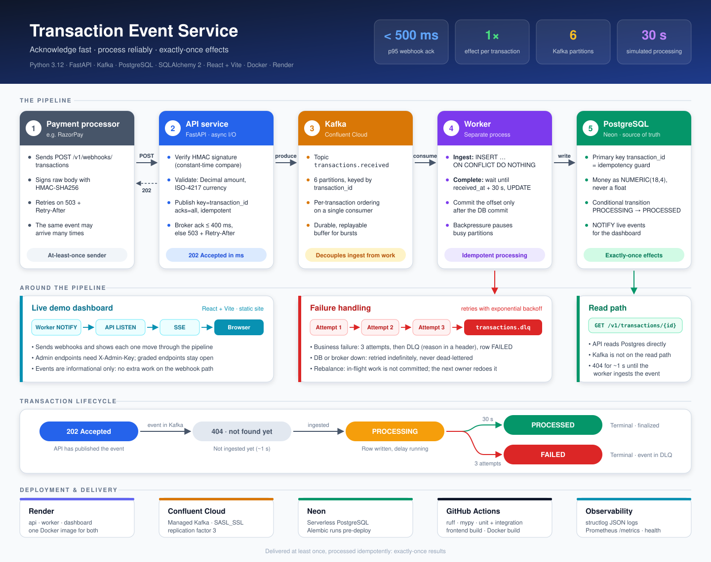

# Transaction Event Service

A webhook-ingestion service for payment processors (e.g. RazorPay). It **acknowledges each webhook in milliseconds** and **processes it reliably in the background**. Repeated webhooks for the same transaction are processed **exactly once**.

**Stack:** Python 3.12 · FastAPI · Kafka (Confluent Cloud) · PostgreSQL (Neon) · SQLAlchemy 2 + Alembic · Docker · Render · GitHub Actions · React + Vite (demo dashboard)

> **Live deployment:** the public API (interactive docs at `/docs`) and the demo dashboard run on Render. Their URLs are shared with the submission and are deliberately not kept in this repository.

---

## Table of contents

1. [Overview](#1-overview)
2. [Architecture](#2-architecture)
3. [Quick start](#3-quick-start)
4. [API reference](#4-api-reference)
5. [Testing](#5-testing)
6. [Demo dashboard](#6-demo-dashboard)
7. [Configuration](#7-configuration)
8. [Deployment](#8-deployment-confluent-cloud--neon--render)
9. [Design decisions](#9-design-decisions)
10. [Project layout](#10-project-layout)

---

## 1. Overview

### What it does

1. A payment processor sends `POST /v1/webhooks/transactions`.
2. The API validates the payload, publishes it to Kafka and replies `202 Accepted`.
3. A separate worker consumes the event, stores it in PostgreSQL and, after a 30 s simulated processing delay, marks it `PROCESSED`.
4. `GET /v1/transactions/{id}` returns its current status.

---

## 2. Architecture



```
Payment processor ──HTTPS──▶ API service (FastAPI)
                               1. verify HMAC signature (when WEBHOOK_SECRET is set)
                               2. validate payload (exact Decimal money, ISO-4217 currency)
                               3. publish to Kafka: key=transaction_id, acks=all, idempotent producer
                               4. 202 Accepted   (no processing on the request path)
                                     │
                     Kafka topic  transactions.received  (6 partitions)
                                     │
                               Worker service (separate process)
                               per partition, in order:
                                 ingest   → INSERT … ON CONFLICT DO NOTHING  (row = PROCESSING)
                                 complete → wait until received_at + 30s → UPDATE → PROCESSED
                                 commit offset only after the DB commit
                               failures → retries with backoff → transactions.dlq
                                     │
                               PostgreSQL (source of truth) ◀── GET /v1/transactions/{id}
```

### Transaction lifecycle

| Status | Meaning |
|---|---|
| *(404)* | Accepted by the API but not yet ingested (about a second). |
| `PROCESSING` | Row written by the worker; waiting out the 30 s delay. |
| `PROCESSED` | Delay elapsed and the row was finalized. Terminal. |
| `FAILED` | Business failure after 3 attempts; the event is in `transactions.dlq`. Terminal. |

---

## 3. Quick start

There are several ways to run and try it:

| Option | Needs | Best for |
|---|---|---|
| [1. Docker Compose](#option-1-run-everything-locally-with-docker) | Docker | Running the full stack locally |
| [2. Swagger UI](#option-2-test-every-scenario-in-swagger-ui) | A browser | Testing every scenario, locally or on the live deployment |
| [3. Live React dashboard](#option-3-use-the-live-react-dashboard) | A browser | Watching the pipeline work live, with buttons instead of requests |

### Option 1: Run everything locally with Docker

**Prerequisites:** [Docker Desktop](https://www.docker.com/products/docker-desktop/) (or Docker Engine with Compose v2).

```bash
git clone https://github.com/arjunraj15/transaction-event-service.git
cd transaction-event-service
docker compose up --build
```

No cloud accounts are needed. This starts:

| Service | URL | Purpose |
|---|---|---|
| `api` | http://localhost:8000 (docs at `/docs`) | Webhook and query endpoints |
| `worker` | http://localhost:8081/healthz | Kafka consumer that processes transactions |
| `dashboard` | http://localhost:5173 | Demo dashboard UI |
| `postgres` | `localhost:5432` (postgres/postgres) | Database |
| `kafka` | `localhost:9092` | Single-node Kafka (KRaft) |
| `kafka-ui` | http://localhost:8080 | Browse topics and messages |
| `init` | – | One-shot: creates the topics and runs the migrations, then exits |

Then open http://localhost:8000/docs and follow [Option 2](#option-2-test-every-scenario-in-swagger-ui).

- **Shorter demo delay:** `PROCESSING_DELAY_SECONDS=5 docker compose up --build`
- **Stop:** `Ctrl+C`, then `docker compose down`. Add `-v` to also delete the database and Kafka data.

### Option 2: Test every scenario in Swagger UI

No tools are needed beyond a browser. Open the interactive docs:

- **Local (Option 1):** http://localhost:8000/docs
- **Live deployment:** `<your-api-url>/docs` (the URL is in the submission)

For each scenario, expand the endpoint, click **Try it out**, edit the body if needed, then click **Execute**. Use a new `transaction_id` for each fresh test, because a reused one is (correctly) treated as a duplicate.

| # | Scenario | Endpoint | What to do | Expected result |
|---|---|---|---|---|
| 1 | Health check | `GET /` | Execute | `200` `{"status":"HEALTHY","current_time":"…Z"}` |
| 2 | Single transaction | `POST /v1/webhooks/transactions` | Use the body below with `"transaction_id":"txn_demo_001"` | `202` `{"status":"accepted","transaction_id":"txn_demo_001"}` |
| 3 | Status while processing | `GET /v1/transactions/{transaction_id}` | Enter `txn_demo_001` right after step 2 | `200` with `"status":"PROCESSING"` (a `404` in the first second is normal) |
| 4 | Status after 30 s | `GET /v1/transactions/{transaction_id}` | Execute again after ~30 s | `200` with `"status":"PROCESSED"` and `processed_at` set |
| 5 | Duplicate prevention | `POST /v1/webhooks/transactions` | Execute the **same body** 5–10 times (e.g. `txn_dup_001`) | Every call returns `202`. `GET` shows one row, and `transactions_processed_total` in `GET /metrics` rises by exactly 1 |
| 6 | Unknown transaction | `GET /v1/transactions/{transaction_id}` | Enter `txn_does_not_exist` | `404` |
| 7 | Invalid amount | `POST /v1/webhooks/transactions` | Set `"amount": -5` (or `0`) | `422` |
| 8 | Invalid currency | `POST /v1/webhooks/transactions` | Set `"currency": "RUPEES"` | `422` |
| 9 | Missing field | `POST /v1/webhooks/transactions` | Delete `source_account` from the body | `422` |
| 10 | Readiness (DB + Kafka) | `GET /health/ready` | Execute | `200` `READY` (`503` if either is down) |
| 11 | Metrics | `GET /metrics` | Execute | Prometheus text, including `transactions_processed_total` |
| 12 | Runtime settings | `GET /v1/meta` | Execute | `200` with the processing delay and whether a signature is required |

Request body for the webhook endpoint:

```json
{
  "transaction_id": "txn_demo_001",
  "source_account": "acc_user_789",
  "destination_account": "acc_merchant_456",
  "amount": 1500,
  "currency": "INR"
}
```

**Notes**
- **Reliability (worker restart):** send a webhook, restart the worker (`docker compose restart worker`) within the 30 s window, then `GET` the transaction. It still ends up `PROCESSED`, once.
- **Admin endpoints:** `GET /v1/transactions` and `GET /v1/events/stream` need an `X-Admin-Key` header when `ADMIN_API_KEY` is set (always on the live deployment, never locally). Enter the key in the `x-admin-key` field in the endpoint's parameters. Without it these return `401`.
- **Shorter wait locally:** `PROCESSING_DELAY_SECONDS=5 docker compose up --build`.

### Option 3: Use the live React dashboard

A browser-based demo UI that sends the webhooks for you and shows the pipeline working in real time. No Swagger and no curl needed. See [Demo dashboard](#6-demo-dashboard) for details.

- **Live deployment:** open the dashboard URL from the submission, and enter the **admin key** from the submission when asked.
- **Local (Option 1):** open http://localhost:5173. No key is needed locally.

**Walkthrough**

| Step | Where | What to do | What you should see |
|---|---|---|---|
| 1 | Header | Check the status badges | API, Postgres, Kafka and the live stream show healthy |
| 2 | **Single** tab | Click send | `202` in the live log in milliseconds. The pipeline lights up Webhook API → Kafka → Worker → Postgres, a 30 s countdown bar runs, then the row becomes `PROCESSED` |
| 3 | **Duplicates** tab | Choose N (e.g. 10) and send | N parallel `202` responses, but only one transaction row, processed once. The log shows `duplicate_ignored` |
| 4 | **Load burst** tab | Choose up to 200 requests at up to 20 concurrent and send | p50 / p95 / max latency and a histogram, with all responses `202` |
| 5 | **Negative** tab | Send an invalid or malformed payload, then look up an unknown id | `422` for invalid bodies, `404` for an unknown id |
| 6 | Transactions tables | Click any row | The raw `GET /v1/transactions/{id}` response |

### Option 4: Run from source

**Prerequisites:** Python 3.12, [uv](https://docs.astral.sh/uv/getting-started/installation/), and Docker for the local Postgres and Kafka.

```bash
docker compose up -d postgres kafka        # just the infrastructure (from the repo root)
cd backend
uv sync                                    # create .venv and install dependencies (from uv.lock)
cp .env.example .env                       # local defaults; don't overwrite an existing .env that holds real credentials
uv run python scripts/create_topics.py     # create transactions.received + transactions.dlq
uv run alembic upgrade head                # create the transactions table
```

Start the two processes in separate terminals, both in `backend/`:

```bash
uv run uvicorn txn_service.api.main:app --reload --port 8000    # terminal 1: API
uv run python -m txn_service.worker.main                         # terminal 2: worker
```

To use cloud services instead (Confluent Cloud, Neon), put their values in `backend/.env`. See [Configuration](#7-configuration) and [Deployment](#8-deployment-confluent-cloud--neon--render).

---

## 4. API reference

Interactive docs are served at `/docs` (OpenAPI / Swagger UI).

### Endpoints

| Method & path | Description | Responses |
|---|---|---|
| `POST /v1/webhooks/transactions` | Receive a transaction webhook | `202` accepted · `401` bad signature · `422` invalid body · `503` broker unavailable, retry |
| `GET /` | Liveness / health check | `200 {"status":"HEALTHY","current_time":"…Z"}` |
| `GET /v1/transactions/{transaction_id}` | Transaction status | `200 [ {...} ]` · `404` |
| `GET /health/ready` | Readiness: DB + Kafka reachable | `200` / `503` |
| `GET /metrics` | Prometheus metrics | `200` |
| `GET /docs` | OpenAPI / Swagger UI | `200` |
| `GET /v1/meta` | Non-secret runtime settings, e.g. the processing delay (dashboard) | `200` |
| `GET /v1/transactions?limit=&status=` | Admin: recent transactions, newest first (dashboard) | `200 [ {...} ]` · `401` without `X-Admin-Key` |
| `GET /v1/events/stream` | Admin: live events as Server-Sent Events (dashboard) | `200 text/event-stream` · `401` without `X-Admin-Key` |

### Webhook payload

| Field | Type | Notes |
|---|---|---|
| `transaction_id` | string | Unique; used as the idempotency key and Kafka partition key |
| `source_account` | string | |
| `destination_account` | string | |
| `amount` | number | Parsed as an exact `Decimal` |
| `currency` | string | ISO-4217 code, e.g. `INR` |

If `WEBHOOK_SECRET` is set, the raw body must be signed with HMAC-SHA256 (RazorPay-style) or the request is rejected with `401`.

### Example

```bash
curl -i -X POST "$BASE_URL/v1/webhooks/transactions" \
  -H "Content-Type: application/json" \
  -d '{"transaction_id":"txn_abc123def456","source_account":"acc_user_789","destination_account":"acc_merchant_456","amount":1500,"currency":"INR"}'
# HTTP/1.1 202 Accepted
# {"status":"accepted","transaction_id":"txn_abc123def456"}

curl "$BASE_URL/v1/transactions/txn_abc123def456"
# [{"transaction_id":"txn_abc123def456", ..., "status":"PROCESSING","created_at":"…","processed_at":null}]
# ~30 s later: "status":"PROCESSED","processed_at":"…"
```

---

## 5. Testing

### Automated tests

Backend, from `backend/`:

```bash
uv run pytest tests/unit                  # fast; no Docker or cloud needed (fakes + deterministic clock)
uv run pytest tests/integration           # real Postgres + Kafka via Testcontainers; needs Docker (skipped otherwise)
uv run ruff check . && uv run ruff format --check . && uv run mypy   # lint, format, strict type checks
k6 run -e BASE_URL=$BASE_URL loadtest/webhooks.k6.js                # load test (needs k6: https://k6.io)
```

Frontend, from `frontend/`:

```bash
npm ci && npm run typecheck && npm test && npm run build
```

CI (GitHub Actions) runs lint, type checks, unit and integration tests, the frontend type check, tests and build, and a Docker build on every push and PR.

### Verifying the success criteria

| Scenario | How to check it by hand | Automated |
|---|---|---|
| 1. Single transaction | POST once, then GET: `PROCESSING` → `PROCESSED` after ~30 s | `test_single_transaction_processed_after_delay` |
| 2. Duplicate prevention | POST the same body 5–10 times. There's one row, `attempts = 1`, and `transactions_processed_total` rises by exactly 1 | `test_duplicate_webhooks_processed_exactly_once` |
| 3. Performance | `k6 run -e BASE_URL=$BASE_URL backend/loadtest/webhooks.k6.js` (200 VUs; fails unless p95 < 500 ms and 100% of responses are 202) | k6 thresholds |
| 4. Reliability | Restart the worker during the 30 s window. The transaction still ends up `PROCESSED`, once | `test_worker_crash_mid_delay_does_not_lose_transaction`, `test_poison_message_goes_to_dlq` |

Quick duplicate check:

```bash
for i in 1 2 3 4 5; do
  curl -s -o /dev/null -w "%{http_code} %{time_total}s\n" -X POST "$BASE_URL/v1/webhooks/transactions" \
    -H "Content-Type: application/json" \
    -d '{"transaction_id":"txn_dup_1","source_account":"a","destination_account":"b","amount":10,"currency":"INR"}'
done
```

---

## 6. Demo dashboard

A React dashboard replaces the curl commands with buttons and shows the pipeline working live. It is a core part of how the service is reviewed. The graded endpoints are unchanged and stay open, and the dashboard calls them exactly as any client would. Its own admin endpoints need an **admin key**, which is shared with the submission.

### Features

- **Send webhooks**, with one tab per success criterion:
  - **Single:** one webhook, processed after ~30 s.
  - **Duplicates:** N parallel posts with the same `transaction_id`, processed once.
  - **Load burst:** up to 200 unique webhooks at up to 20 concurrent, with p50/p95/max and a latency histogram.
  - **Negative:** invalid or malformed payloads return 422, and an unknown id returns 404.
- **Live pipeline:** Webhook API → Kafka → Worker → Postgres. Each node lights up as events pass through it, and every in-flight transaction has a 30 s countdown bar.
- **Transactions:** in-progress and completed tables. Click a row to see the raw `GET /v1/transactions/{id}` response.
- **Live log:** the browser's own requests (status and latency) merged with the worker's events (`ingested`, `duplicate_ignored`, `processed in 30.00 s`, …).
- **Header:** API, Postgres, Kafka and live-stream health, plus the server-side webhook latency read from `/metrics`.

### How live updates work

At each state change the worker sends a small JSON event with Postgres `NOTIFY`. Each API process holds one `LISTEN` connection and pushes the events to browsers over **Server-Sent Events** (`GET /v1/events/stream`). Postgres is already shared by every process, so no extra infrastructure is needed. The events are informational only: the webhook request path does no extra work, the database row stays the source of truth, and a failed `NOTIFY` never affects processing. The dashboard also re-syncs from `GET /v1/transactions` every 15 s and after each reconnect.

### How it's deployed

The dashboard is a **separate static site** (HTML, JS and CSS on Render's CDN). It is never served by the API.

| Concern | How it's handled |
|---|---|
| Hosting | Render Static Site (`txn-dashboard` in [`render.yaml`](render.yaml)), built from `frontend/` with its own pipeline. The API image contains no frontend code. |
| API access | The dashboard calls the API on its own domain, at `VITE_API_BASE` (baked in at build time). The API's **CORS allow-list** contains exactly the dashboard's origin (`CORS_ALLOWED_ORIGINS`). Both are set in Render (`sync: false`), not kept in the repo. |
| Auth | `GET /v1/transactions` (list) and `GET /v1/events/stream` require `X-Admin-Key`. Render generates the key (`generateValue`), so it never exists in git. The stream is read with `fetch()` rather than `EventSource`, so the key stays in a header and out of URLs and proxy logs. The key is kept in `sessionStorage` for the tab only. |
| Graded endpoints | `POST /v1/webhooks/transactions`, `GET /` and `GET /v1/transactions/{id}` are unchanged and open, as the brief requires. |
| Caching | Content-hashed `/assets/*` files are cached for a year (`immutable`); `index.html` is `no-cache`, so a new deploy shows up immediately. |
| Security headers | CSP (`connect-src` limited to the API), `nosniff`, `no-referrer`, and `frame-ancestors 'none'`. |

*At larger scale or with real customer data,* the dashboard would sit behind **SSO** (Okta, Google Workspace, Cloudflare Access) instead of a shared key, on one domain with path routing (`/` → CDN, `/api` → API), and the admin endpoints would live on an internal API separate from the public webhook.

### Run it locally

`docker compose up --build` starts a `dashboard` service at http://localhost:5173. The Vite dev server proxies to the API, so it's same-origin and needs no CORS. No `ADMIN_API_KEY` is set locally, so the admin endpoints are open. To work on the UI alone:

```bash
cd frontend && npm install
npm run dev                                                    # http://localhost:5173, proxied to the API on :8000
VITE_API_TARGET=$BASE_URL npm run dev                          # or against a deployed API (asks for the admin key)
```

---

## 7. Configuration

All backend settings are environment variables (see `backend/.env.example` and `backend/src/txn_service/config.py`).

| Variable | Default | Purpose |
|---|---|---|
| `DATABASE_URL` | local Postgres | Any `postgres://`, `postgresql://` or `postgresql+asyncpg://` URL |
| `KAFKA_BOOTSTRAP_SERVERS` | `localhost:9092` | Broker list |
| `KAFKA_SECURITY_PROTOCOL` | `PLAINTEXT` | `SASL_SSL` for Confluent Cloud |
| `KAFKA_API_KEY` / `KAFKA_API_SECRET` | – | SASL/PLAIN credentials |
| `KAFKA_TOPIC_TRANSACTIONS` / `KAFKA_TOPIC_DLQ` | `transactions.received` / `transactions.dlq` | Topics |
| `PRODUCE_TIMEOUT_SECONDS` | `0.4` | Broker-ack budget inside the 500 ms SLA |
| `PROCESSING_DELAY_SECONDS` | `30` | Simulated external processing time |
| `PROCESSING_MAX_ATTEMPTS` | `3` | Attempts before dead-lettering |
| `WEBHOOK_SECRET` | – | Enables HMAC signature verification |
| `EVENTS_CHANNEL` | `txn_events` | Postgres LISTEN/NOTIFY channel for the dashboard's live events |
| `ADMIN_API_KEY` | – | Required in `X-Admin-Key` for the admin endpoints when set (Render generates it) |
| `CORS_ALLOWED_ORIGINS` | – | Comma-separated browser origins allowed to call the API (a bare host means `https://`) |

---

## 8. Deployment (Confluent Cloud + Neon + Render)

### Step 1: Kafka (Confluent Cloud)

Create a *Basic* cluster and an API key, then create the topics once (from `backend/`):

```bash
KAFKA_BOOTSTRAP_SERVERS=<bootstrap:9092> KAFKA_SECURITY_PROTOCOL=SASL_SSL \
KAFKA_API_KEY=<key> KAFKA_API_SECRET=<secret> KAFKA_TOPIC_REPLICATION_FACTOR=3 \
uv run python scripts/create_topics.py
```

### Step 2: PostgreSQL (Neon)

Create a project and copy its **direct** (non-pooled) connection string. The `postgresql://…?sslmode=require` form can be used as-is. The app keeps its own connection pool, and PgBouncer's transaction pooling doesn't work well with asyncpg prepared statements.

### Step 3: Render

Click *New → Blueprint*, select this repo, and Render reads [`render.yaml`](render.yaml):

- **txn-api** (web service, Starter): builds `backend/Dockerfile` (context `backend/`), runs `alembic upgrade head` as a pre-deploy step, and health-checks `/health/ready`.
- **txn-worker** (background worker, Starter): same image, started with `python -m txn_service.worker.main`.
- **txn-dashboard** (static site): the React demo dashboard.
- Generic settings (SASL_SSL, replication factor 3, the 30 s delay) live in the `txn-shared` environment group.

Everything environment-specific, meaning secrets and infrastructure endpoints, is marked `sync: false`: Render prompts for it, and it is never stored in git.

| Variable | Services | Value |
|---|---|---|
| `DATABASE_URL` | api, worker | Neon connection string |
| `KAFKA_BOOTSTRAP_SERVERS` | api, worker | Confluent cluster bootstrap server (`host:9092`) |
| `KAFKA_API_KEY` / `KAFKA_API_SECRET` | api, worker | Confluent API key and secret |
| `WEBHOOK_SECRET` | api | Enables signature verification when set |

`ADMIN_API_KEY` is generated by Render. After the first deploy, set the two public URLs (both `sync: false`):

| Variable | Service | Value |
|---|---|---|
| `CORS_ALLOWED_ORIGINS` | api | the dashboard's public URL (`https://…`) |
| `VITE_API_BASE` | dashboard | the API's public URL (`https://…`). It's baked in at build time, so redeploy the dashboard after setting it. |

*(Render's `fromService … property: host` gives the private-network hostname, which browsers can't reach, so it isn't used for these.)*

Both backend services run on always-on Starter instances in Singapore, so there are no cold starts that could break the 500 ms SLA.

### Step 4: Smoke test

```bash
curl https://<api-domain>/health/ready
```

Then run the scenarios in [Testing](#5-testing).

---

## 9. Design decisions

### Technology choices

**FastAPI.** Async I/O keeps the webhook path non-blocking. Pydantic v2 validation and the generated OpenAPI docs come with it.

**Kafka as the ingestion buffer.** Webhook traffic is bursty and processing is slow (30 s), so receiving and processing are separated by a durable, replayable log:
- The API can return 202 as soon as the event is safely stored.
- Consumers scale horizontally up to the partition count.
- Partitioning by `transaction_id` keeps events for one transaction ordered on a single consumer.
- Events can be replayed for recovery or backfills, and failures are isolated in a DLQ.

The API writes only to Kafka. Writing to both the DB and Kafka on the request path would create a dual-write consistency problem.

**Postgres as the source of truth and the idempotency guard.** Kafka delivers at-least-once, and its idempotent producer only removes duplicates caused by producer retries, not repeat webhooks. Exactly-once *effects* come from the database: a primary key, `ON CONFLICT DO NOTHING`, and a conditional state transition. Delivering at least once with idempotent processing gives effectively exactly-once results.

### Worker design

Each partition gets two ordered stages:
- **Ingest** writes the row the moment the event is consumed, so `GET` shows `PROCESSING` straight away.
- **Complete** waits out the delay, finalizes the row, then commits the offset.

Every event has the same delay, so events in a partition come due in the order they arrived, and nothing gets stuck behind a slower event. Other details:
- Backpressure pauses a partition when its in-memory backlog grows too large.
- Rebalances drop in-flight work without committing it, so the next owner safely redoes it.
- Infrastructure errors (DB or broker down) are retried indefinitely with backoff and never dead-lettered.
- Business failures get 3 attempts with exponential backoff, then the event goes to `transactions.dlq` with the reason in a header, and the row is marked `FAILED`.

### Money handling

Amounts are `Decimal` end to end: `NUMERIC(18,4)` in the database and a string inside Kafka messages, never a float. The query response sends a JSON number to match the published contract. *Note:* the brief's example (`150.50`) suggests floats, which a real payments system should not use.

### Security

- RazorPay-style HMAC-SHA256 verification of the raw body (enabled when `WEBHOOK_SECRET` is set), using a constant-time comparison.
- Secrets come only from the environment.
- The container runs as a non-root user.

### Observability

- Structured JSON logs (structlog), with `transaction_id` attached to every log line.
- Prometheus metrics: request latency, webhook outcomes, ingested new vs. duplicate, processed, failed, attempt errors, and end-to-end latency.
- Separate liveness and readiness endpoints, plus a worker health check based on its last poll time.

### Operations

Alembic migrations run as a pre-deploy step rather than `create_all` at startup. One image serves both processes. Shutdown on SIGTERM is graceful: the producer is flushed and the consumer leaves the group promptly.

### Trade-offs and known limitations

- **Read-after-write gap.** For roughly a second after the 202, `GET` can return 404, until the worker has ingested the event. This is the cost of a single durable write on the request path.
- **Publish timeout.** If the broker ack arrives after the 400 ms budget, the API returns 503 even though the event may already be stored. The processor's retry then becomes a duplicate event, which the idempotent worker absorbs.
- **Side effects of a real downstream call.** A crash after the external call but before the DB update means the call is repeated (at-least-once). A real integration would pass `transaction_id` as the idempotency key. The `external_call` hook in `worker/processor.py` is where it would go.

### Production next steps (out of scope here)

OpenTelemetry tracing across API → Kafka → worker · Sentry · Schema Registry with Avro/Protobuf event contracts · autoscaling consumers on lag (KEDA) · a DLQ replay tool and alerting · Terraform for infrastructure · rate limiting and processor IP allow-lists.

---

## 10. Project layout

```
backend/                 Python service (API + worker): one Docker image
  src/txn_service/
    api/                 FastAPI app factory, routes (webhooks, transactions, events, health), auth
    worker/              consumer runtime (partitions, offsets, backpressure) + processor (business logic)
    messaging/           event schemas, Kafka producer/consumer/DLQ
    db/                  SQLAlchemy model, repository (idempotent writes), engine
    events.py            live events for the dashboard (worker NOTIFY → API LISTEN → SSE)
    config.py  logging.py  metrics.py
  alembic/  alembic.ini  migrations
  tests/unit             API, schemas, processor, consumer, events (no infrastructure)
  tests/integration      end-to-end with real Postgres + Kafka (Testcontainers)
  loadtest/              k6 script
  scripts/               topic creation
  pyproject.toml  uv.lock  Dockerfile  .env.example
frontend/                React + Vite demo dashboard (separate static site)
docs/                    architecture diagram
docker-compose.yml       full local stack (infra + api + worker + dashboard)
render.yaml              Render Blueprint (api, worker, dashboard static site)
.github/workflows/ci.yml backend + frontend jobs, Docker build
```

---

## License

See [LICENSE](LICENSE).
